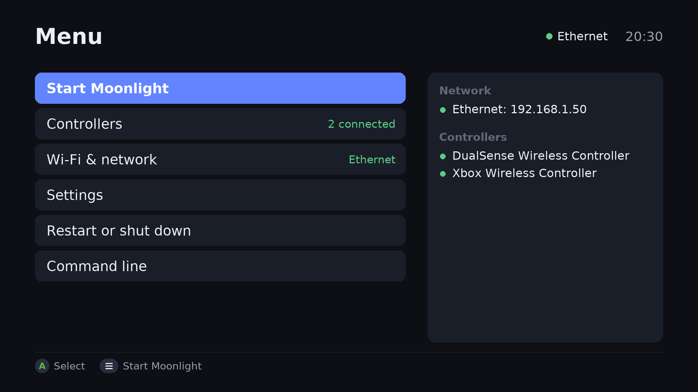

# Moonlight Pi Setup

Turns a **Raspberry Pi 5** into a [Moonlight](https://moonlight-stream.org) game-streaming box for your TV. It boots straight into Moonlight, with hardware HEVC decoding, HDR and surround sound, and has a menu on the TV for controllers, Wi-Fi and settings, so you rarely need a keyboard.



- **Boots into Moonlight**; the TV menu opens when Moonlight closes.
- **Controllers**: pair Bluetooth controllers from the TV, with battery levels.
- **USB sharing**: controllers and headsets plugged into the Pi work on your PC as if plugged into it (DualSense haptics included).
- **Sign-in screens**: PlayStation and other controllers work on Windows' lock screen, sign-in screen and UAC prompts.
- **Away from home** over Tailscale, Wi-Fi setup from your phone, surround sound, and updates from the TV.

Tested on a Pi 5 over wired Ethernet: 2560×1440 at 60 fps, HEVC 10-bit HDR, 5.1 surround, no dropped frames.

## What you need

- A **Raspberry Pi 5** with **Raspberry Pi OS Lite (64-bit)** (Debian 13 "Trixie"), with SSH turned on in Raspberry Pi Imager.
- A gaming PC running [Sunshine](https://github.com/LizardByte/Sunshine), [Apollo](https://github.com/ClassicOldSong/Apollo) or [Vibepollo](https://github.com/Nonary/Vibepollo).
- Wired Ethernet is recommended; Wi-Fi works too.

## Install

On the Pi, over SSH, as your normal user:

```bash
curl -fsSL https://raw.githubusercontent.com/joshmichael/moonlight-pi-setup/main/moonlight-pi-setup.sh | bash
```

It shows what it will do, asks to go ahead, installs everything and offers to restart. On first start, **Quick setup** on the TV asks about speakers, Wi-Fi, USB sharing and Tailscale (you can skip it). Then pair Moonlight with your PC as usual.

### Setting up the gaming PC

Optional (Windows): for USB sharing, sign-in screens and Tailscale, run this in PowerShell on the PC, as your normal user:

```powershell
irm https://raw.githubusercontent.com/joshmichael/moonlight-pi-setup/main/windows/moonlight-pc-setup.ps1 | iex
```

It asks about each part, finds the Pi on your network, and asks Windows for permission when it needs it. Run it again to repair or remove anything.

### Recommended Moonlight settings

**HEVC** (the Pi 5 decodes it in hardware, but not H.264), your TV's resolution or 1440p, 60 FPS, 50–100 Mbit/s on Ethernet, V-Sync on. Audio is set to match your speakers.

## Using it

- **The TV menu** opens when Moonlight closes (press **B** or **Esc** on Moonlight's list of PCs, and confirm). It works with a controller, a keyboard or a mouse.
- **End a stream**: Select+Start+L1+R1 on a controller, or Ctrl+Alt+Shift+Q. Ctrl+Alt+Shift+S shows the performance overlay.
- **Pair a controller**: Controllers → Pair a new controller, then hold Create+PS (PlayStation) or the pair button (Xbox). With no controller at all, the first one in pairing mode pairs by itself.
- **Settings**: speakers (with a test), USB sharing, Tailscale, Wi-Fi, updates, Quick setup again, and uninstall.

### USB sharing

While you stream, USB devices plugged into the Pi go to your PC with USB/IP ([usbip-win2](https://github.com/vadimgrn/usbip-win2) on the PC), and come back when the stream ends. Controllers and headsets go by default; keyboards, mice and storage stay. Choose per device or per port in **Settings → USB sharing**. Devices only go to the PC you're streaming to, and only once it's set up, so a PC that isn't keeps your controller working through Moonlight.

### Controllers on sign-in screens

Windows' lock screen, sign-in screen and UAC prompts only work with Xbox controllers. While one is up during a stream, every other controller also shows up on the PC as an Xbox controller that copies it, so you can type your PIN or press Yes. Your controller itself isn't changed, and the copy goes when the screen does. It's on by default (**Controllers → Sign-in screens**) and needs the PC setup above.

### Away from home

Sign the Pi in to [Tailscale](https://tailscale.com) on the TV (**Settings → Tailscale**, scan the code) with the same account as your PC. Moonlight then finds your PC over Tailscale by itself. Lower the bitrate to below your home upload speed, and turn off key expiry for both machines in the Tailscale admin console.

### Ending the stream at shutdown

When the Pi shuts down, it ends the stream on your PC (and closes the game), so a virtual display doesn't stay stuck. Turn this off in Settings to leave games running.

## Troubleshooting

| What | Where |
|---|---|
| Moonlight | `/tmp/moonlight.log` |
| TV menu | `/tmp/moonlight-menu.log` |
| Setup runs | `~/.local/share/moonlight-pi-setup/` |
| USB sharing | `journalctl -u moonlight-usb-sharing` |
| Sign-in screens | `journalctl -u moonlight-xbox-copy` (PC: `%ProgramData%\moonlight-pi-setup\secure-screen.log`) |

- **No sound or no surround**: sound follows the HDMI port with a screen. To pass surround through a TV to a receiver, the TV needs eARC; otherwise connect the Pi to the receiver. `speaker-test -c 6 -t wav -l 1` tests 5.1.
- **Stutter**: check `ethtool eth0` says 1000Mb/s Full, and lower Moonlight's bitrate.
- **No controller works on Windows' lock screen** (not even an Xbox one): restart the PC.
- Running the install command again repairs the setup and keeps your settings.

## Updating and uninstalling

Update from the TV (**Settings → Updates**) or run the install command again. To uninstall, use **Settings → Uninstall this setup** on the TV, or run `~/.local/share/moonlight-pi-setup/moonlight-pi-setup.sh --uninstall`. It puts the Pi back the way it was; run the PC setup again to remove its parts from the PC.

## Limitations

- Raspberry Pi 5 with Raspberry Pi OS Lite only. 7.1 audio is experimental, and the Pi 5 has no VRR.
- USB sharing and sign-in screens need a Windows PC. A few USB devices don't work with usbip-win2.
- A Switch Pro controller sent to the PC by USB sharing only gets a sign-in copy while Steam is running there: set it to Never in USB sharing to keep it on the Pi.

## Licence

MIT. Please [open an issue](https://github.com/joshmichael/moonlight-pi-setup/issues) if something doesn't work. Moonlight, Tailscale, usbip-win2 and the Linux USB/IP tools are separate projects with their own licences.
